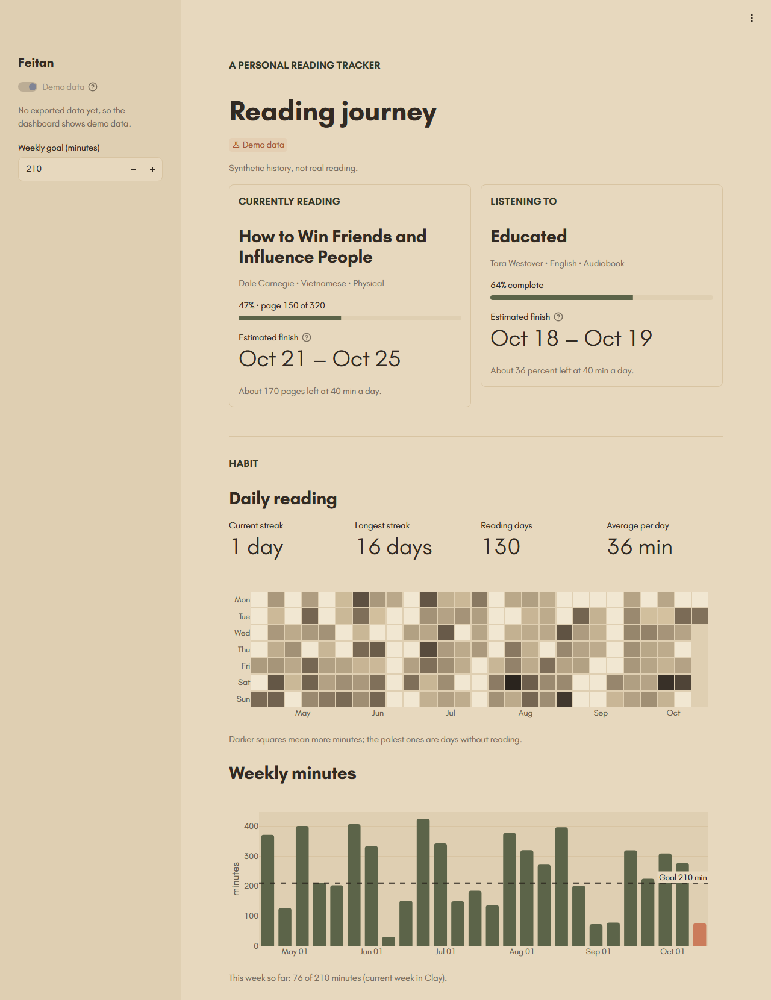

# Reading Tracker

[](https://github.com/feitandodatascience/reading-tracker/actions/workflows/ci.yml)

[](https://github.com/astral-sh/uv)
[](https://github.com/astral-sh/ruff)
[](https://tung-anh-reading.streamlit.app)

I read in English and Vietnamese, mostly paper books. This project logs every
reading session in a few seconds and turns them into a public dashboard of my
reading habits, with a simple estimate of when I'll finish the current book.



<sub>Shown with the synthetic demo data that ships with the repo.</sub>

## What it does

- **Logs reading in under 10 seconds.** A private Streamlit tracker with one big
  Start and one big Stop button, prefilled with the page where I stopped last time.
  Past sessions, new books, and finished or abandoned books go in expanders.
- **Shows the journey.** A public dashboard: current book and finish estimate,
  streaks and a calendar heatmap, weekly minutes against a goal, pace by genre,
  format or language, and a timeline of finished books.
- **Estimates the finish date.** A transparent baseline: pages left ÷ recent
  median pace ÷ recent minutes per day, shown as a date range.

## How it works

```
tracker (private) ──> data/raw/reading.db ──> export.py ──> data/processed/*.parquet ──> dashboard (public)
                       SQLite, gitignored     drops notes,                                    ▲
                                              floors times to the hour                        │
synthetic.py ──> data/demo/demo.db (seeded, labelled "Demo data") ───────────────────────────┘
```

- **Raw events only.** SQLite stores books and sessions. Duration, pace,
  streaks and progress are derived in pandas (`features.py`), never stored.
- **Validated at the source.** One active session at a time, no overlapping or
  future sessions, positions within the book, timestamps with their UTC offset.
- **Private by design.** The real database never leaves my machine. The public
  data has no notes, start times rounded down to the hour, and no end times.
- **On brand.** The Regent palette and type of my portfolio site (Libre Bodoni and
  Jost), defined once in `brand.py` and `.streamlit/config.toml`.

## Run it

Requires [uv](https://docs.astral.sh/uv/).

```bash
uv sync
uv run streamlit run app/dashboard.py                           # dashboard (demo data out of the box)
uv run streamlit run app/tracker.py --server.address localhost  # private tracker
uv run python -m reading_tracker.export                         # publish my data to the dashboard
uv run pytest                                                   # 200+ tests
```

On Windows, `app/start_tracker.pyw` and `app/start_dashboard.pyw` start each app
with a double-click.

## Project structure

```
app/                  tracker.py, dashboard.py, double-click launchers, static/fonts
src/reading_tracker/  db · log (validation) · features · eta · synthetic · export · brand
data/                 raw/ (private, gitignored) · demo/ · processed/ (public)
tests/                unit tests and click-through app tests (Streamlit AppTest)
```

**Stack:** Python 3.12, uv, SQLite, pandas, Streamlit, Plotly, ruff, pytest,
GitHub Actions.

## Roadmap

- [x] **v1.0:** tracker, features, demo data, privacy-safe export, baseline ETA, branded dashboard
- [ ] Import my reading history from Toggl
- [x] Deploy the dashboard to Streamlit Community Cloud: [tung-anh-reading.streamlit.app](https://tung-anh-reading.streamlit.app)
- [ ] Bayesian time-to-finish model with a backtest (`notebooks/02_eta_model.ipynb`)

See [CHANGELOG.md](CHANGELOG.md) for what changed in each version.

## License

The code is released under the [MIT License](LICENSE). The Libre Bodoni and Jost
fonts are under the [SIL Open Font License](app/static/fonts/OFL.txt). My personal
reading data (`data/processed/`) and personal brand (`brand.md`, `assets/`) are
not covered by the MIT License.
